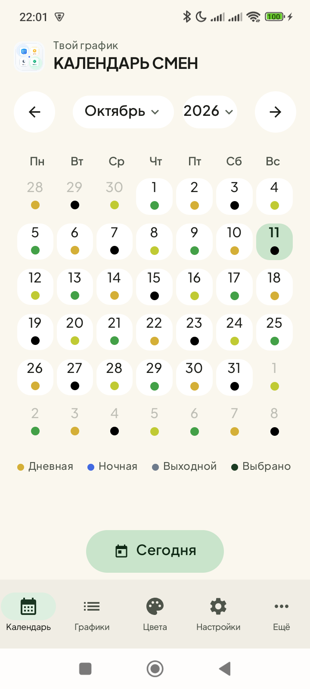
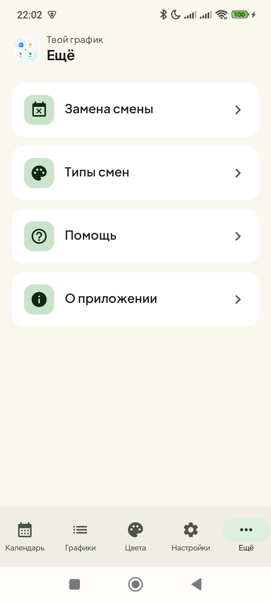
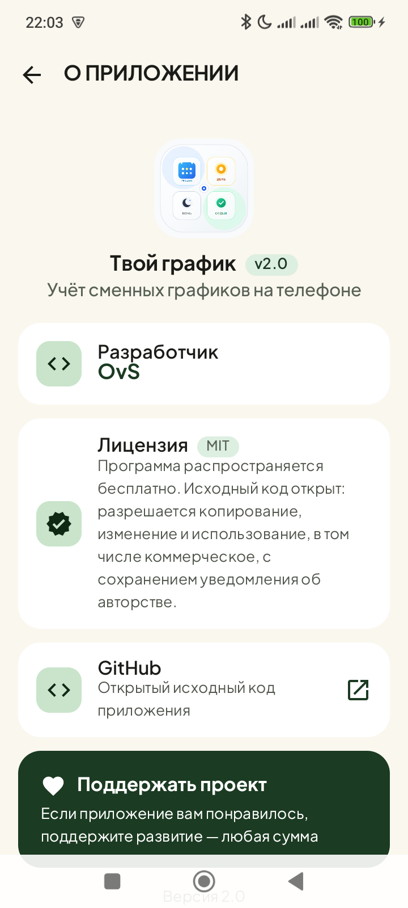
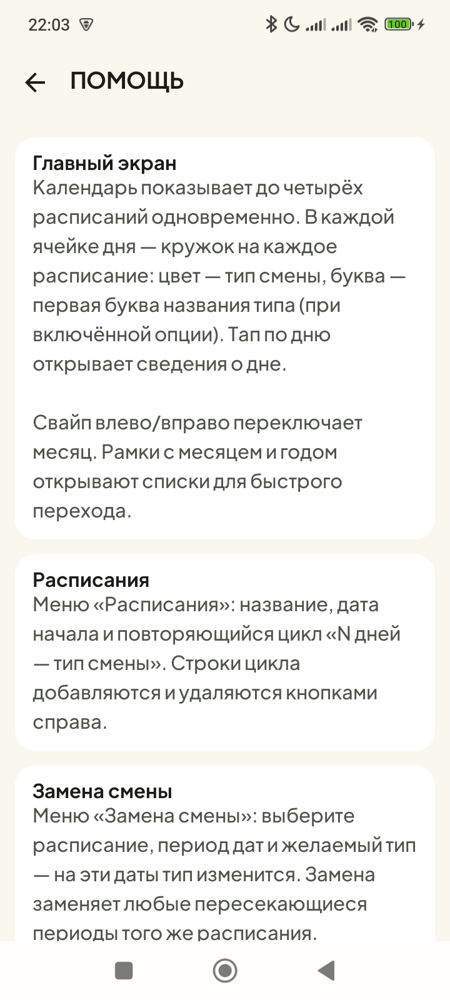
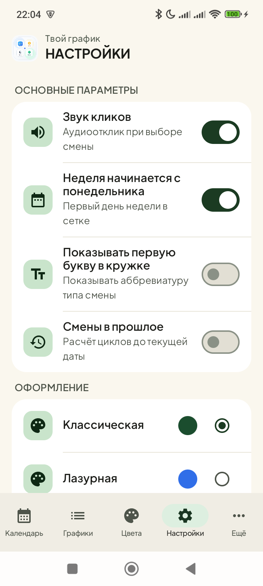
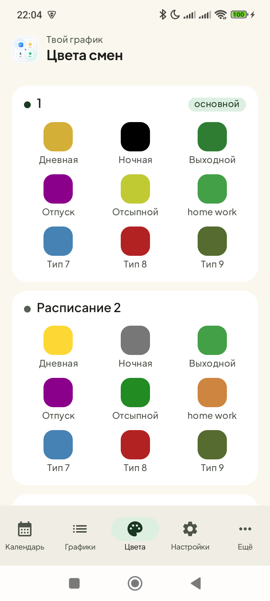

# Твой график

**Учёт сменных графиков на телефоне** — нативное Android-приложение на Kotlin + Jetpack Compose (Material 3). Быстрое, полностью офлайн, с минимальным набором разрешений.

[](LICENSE)
[](https://www.android.com/)
[](https://github.com/ovs6387/shiftik/releases)

## Что умеет

- **Календарь смен** — сменный цикл по расписаниям на 1–2 месяца вперёд, свайпы по месяцам, быстрый переход к «Сегодня»
- **Расписания** (до 4 слотов) — произвольный паттерн «N дней одного типа», дата начала цикла; опция **«Смены в прошлое»** — цикл работает в обе стороны
- **Замена смены** — периоды (начало–конец), перекрывающие расчёт на любой слот
- **Типы смен и цвета** — 9 типов (Дневная, Ночная, Выходной, Отпуск + 5 свободных), скрытие ненужных, свои цвета на каждый слот
- **Будильник о смене** — отдельный точный будильник на каждый (день, тип) на 62 дня вперёд; **своё время на тип смены**; восстановление после перезагрузки
- **Зеркало в системных «Часах»** — будильник о смене появляется в списке системного приложения «Часы» (по одному на тип — ближайшая смена) и звонит средствами системы; после звонка запись сама исчезает из списка
- **Текст уведомления** — редактируемый по каждому типу смены, с подстановками `{тип}`, `{расписание}`, `{время}`, `{дата}`; в уведомлении заголовок и текст — двумя строками
- **Темы оформления** — «Классическая» (тёплая) и «Лазурная» (прохладная перваншь), светлая и тёмная
- **Языки**: русский и английский
- **Звук кликов** и тактильная отдача — системные

## Разрешения — только для будильника

| Разрешение | Зачем |
|---|---|
| `POST_NOTIFICATIONS` | уведомления «смена начинается» (Android 13+) |
| `RECEIVE_BOOT_COMPLETED` | восстановление будильников после перезагрузки |
| `SCHEDULE_EXACT_ALARM` | точные будильники в назначенное время |
| `com.android.alarm.permission.SET_ALARM` | зеркальный будильник в системных «Часах» |

Интернет, геолокация и доступ к файлам не используются вообще.

## Установка

Скачайте APK из [Releases](https://github.com/ovs6387/shiftik/releases) и установите на телефон (Android 8+).

## Сборка из исходников

Нужны: JDK 17+, Android SDK (platform 35).

```
./gradlew assembleDebug        # отладочная сборка
./gradlew assembleRelease      # release: R8 + shrinkResources, ~1,7 МБ
adb install -r app/build/outputs/apk/release/app-release.apk
```

## Технологии

Kotlin 2.2 · Jetpack Compose (Material 3) · Navigation Compose · Lifecycle/ViewModel · AlarmManager · SharedPreferences · minSdk 26 / targetSdk 35

## Скриншоты

| Главный экран | Меню | О приложении |
|---|---|---|
|  |  |  |

| Помощь | Настройки | Цвета |
|---|---|---|
|  |  |  |

## Поддержка

Если приложение вам понравилось — поддержите развитие: [Поддержать проект](https://yoomoney.ru/fundraise/1JMMTMIO40L.260816)

## Лицензия

Распространяется по лицензии [MIT](LICENSE) — можно использовать, изменять и распространять, в том числе коммерчески, с сохранением уведомления об авторстве. © 2026 OvS